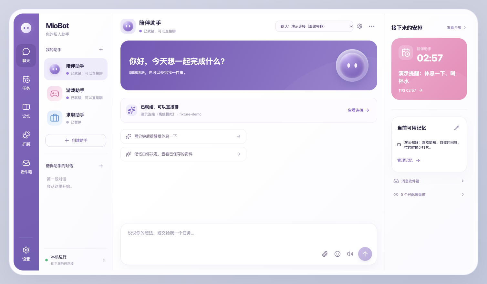
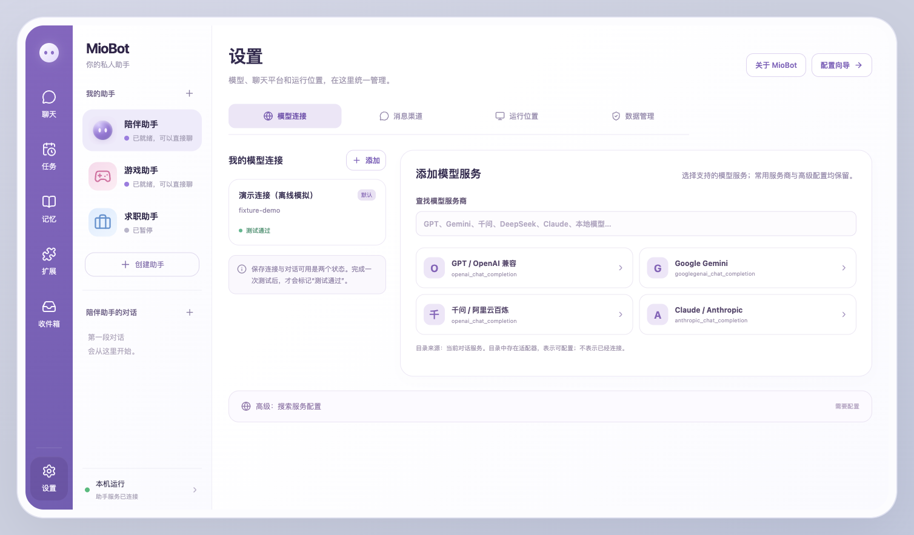

<div align="center">


# MioBot

**有自己的性格，记得你的偏好，替你记着要做的事。**

一个可自行部署的个人 AI 助手，把聊天、人设、记忆、联网和提醒收进同一个界面。

`0.5.0 · 早期预览` · `macOS Apple Silicon` · `AGPL-3.0`

[功能介绍](#能用它做什么) · [快速开始](#快速开始) · [云端部署](README-cloud.md) · [开发说明](docs/DEVELOPMENT.md) · [开源组件](THIRD_PARTY.md)

</div>

---

MioBot 想让个人助手更容易长期使用。你可以给助手起名字、调整说话方式，让它记住重要偏好，在聊天里安排提醒，也可以把日常、陪伴和特定场景交给不同的助手。

项目的目标形态是**本地和云端可选，电脑与手机连接同一个助手后台**。当前提供可运行的桌面项目、浏览器界面与云端服务代码；macOS arm64 已做本机测试，手机端的完整体验、周期任务和真实 Linux 云部署仍在路线图或待验收范围内。

本仓库公开的是源码预览版。使用模型、搜索和语音服务需要自己的账号或 API，仓库不含服务额度、个人聊天记录和现用账号配置。当前未提供经过正式签名的二进制发行版。

## 界面预览

紫白配色、卡片布局和轻量动态效果。聊天与任务、记忆、模型配置保持在同一套界面里。





以上为实际 Web 前端的隔离演示截图，与桌面共用页面。所有提醒、偏好和模型连接均为离线模拟数据；“测试通过”来自测试服务，不代表真实模型或消息平台已经验收。联网仍需配置自己的搜索服务。

## 能用它做什么

### 给每个助手设定合适的性格

- 创建、编辑和启用自己的助手，分别设置名称、角色提示词和默认模型。
- 提供陪伴、游戏和求职场景的预设，可继续修改。
- 陪伴助手偏向熟人式交流和轻微吐槽，游戏、求职助手保留各自的任务口吻。
- 内置表达规则、时间上下文、会话连续性及回复清理；按短段呈现回复，支持停止与失败重试。
- 侧栏机器人会轻微跟随鼠标转头，尊重系统减少动态效果设置，不为这个动画调用模型。

人格设定用于调整表达方式。回答质量仍取决于所选模型、上下文和真实可用工具；模型没有执行工具时，不能把口头答应当作已经完成。

### 记住重要资料，保留管理权

在聊天里明确说“记住……”可以保存基础跨会话资料，无需额外向量模型。例如：

> 记住我喜欢简短直接的回答。

基础资料默认按助手隔离，可以查看、编辑、删除或明确共享。每轮只选取有限资料加入上下文，避免把整份记忆库重复发给模型。另内置可选增强记忆，配置向量与摘要服务后，通过工具写入和召回长期记忆。

### 在聊天里安排一次性提醒

> 两分钟后提醒我休息一下。

> 明天早上七点叫我起床。

明确时间和内容后创建真实任务；只有“明天早上”时先追问具体时刻。可以在任务页查看、暂停、取消或修改时间；表单创建的草稿需要确认，修改时间后也需要重新确认。

提醒可进入应用收件箱，桌面版会尝试系统通知。外部渠道投递需要适配器支持、接收对象绑定和真实送达验证。当前支持一次性提醒，**尚不支持“每天九点自动搜索并生成日报”这样的周期工作流**。

### 查询网页资料与阅读附件

联网功能使用已配置的官方 DeepSeek 搜索或 Tavily，返回带来源的网页摘要供模型组织回答。已有合适的 DeepSeek 连接可作为搜索凭据引用，无需重复保存密钥；使用其他聊天模型时仍需配置受支持的搜索服务。

文件阅读作为可选能力，支持上传 TXT、Markdown、PDF 和 DOCX，再让助手按已上传资料回答。只读取当前用户与助手拥有的附件，不向模型开放任意本机文件路径。

### 允许助手偶尔主动联系

陪伴助手可单独启用主动关心：在一段时间没有新消息时，结合有限的近期对话生成轻量问候。

- 默认关闭，由用户选择开启。
- 提供免打扰时段、空闲间隔和每日次数限制。
- 上一次问候没有得到回应时，不继续反复催促。
- 本地模式需要应用与模型后台持续可用；云端模式需要完整的云端服务持续运行。

### 按需要增加能力

- **多模型连接**：OpenAI 兼容、Gemini、Anthropic 等服务商适配，另有 DeepSeek、千问等连接预设。可读取模型列表、保存连接并做真实短请求测试。
- **消息渠道配置**：从固定版本运行时读取已加载适配器目录，绑定助手、保存配置并查看状态。QQ、Discord、Telegram 等真实账号需另外接通；目录中出现不等于已经登录和收发通过。
- **Minecraft 资料工具**：内置 Java Edition 1.21.8 的固定物品与合成资料，可查配方和计算一层直接材料；不连接游戏世界，也不替玩家采集、建造或战斗。
- **可选语音与私有图库**：有服务配置和上传、管理、发送入口；语音需要自己的合成服务，图库按助手管理。音质和外部平台发送效果仍需实际验证。

基础记忆、联网与提醒在日常界面默认内置；语音、图库、文件阅读和增强记忆按需配置。详细行为见[功能与边界](docs/FEATURES.md)。

## 当前版本状态

“已验证”说明存在相应测试，不代表所有模型、系统和账号都已验收。

| 能力 | 当前状态 |
| --- | --- |
| 聊天、独立人设、模型连接管理 | 已实现；有本机运行与模型请求记录 |
| 基础跨会话记忆与助手隔离 | 已实现；有隔离测试及跨新会话样例 |
| 一次性提醒、暂停、取消与收件箱 | 已实现；有自动化与本机链路测试 |
| 网页搜索及来源展示 | 已实现；有真实搜索样例，仍取决于服务配置 |
| 增强记忆与 Minecraft 资料工具 | 已接入；有原生引擎测试和少量真实请求样例 |
| 陪伴助手主动关心 | 已实现；有隔离测试，未做长期真人体验评估 |
| 文件、语音和私有图库 | 已实现可选工具与配置；有自动化测试，外部服务体验待继续验收 |
| macOS arm64 桌面打包 | 已构建并做本机测试；未完成独立新电脑安装验收和正式签名发行 |
| 完整云端服务与桌面配对 | 已实现；本机双服务测试通过，真实 Linux Docker 构建部署待验收 |
| QQ / Discord / Telegram 等真实渠道 | 有配置与对接入口；当前版本未完成真实账号端到端验收 |
| 手机端完整体验与跨设备统一身份 | 规划中；已有窄屏布局不等于手机产品验收完成 |
| 周期提醒、定时搜索与自动简报 | 尚未实现 |
| B站 / 抖音专用连接、插件市场安装 | 尚未接通或验收 |
| Hermes 集成、多 Agent 协作、通用终端操作 | 未集成，不属于当前版本能力 |

## 快速开始

### 从源码运行

当前源码路径按 macOS 开发流程验证。需要 Git、Node.js 24+ 和用于准备 Python 3.12 环境的 [uv](https://docs.astral.sh/uv/)。首次安装需要访问 npm、GitHub 和 Python 包源。

```sh
git clone https://github.com/YEMIN11238/MioBot.git
cd MioBot
npm ci
zsh ./安装引擎.command
```

安装脚本获取固定版本的引擎、复制依赖锁、应用托管补丁，并补齐当前增强记忆所需依赖。完成后构建界面，选择一种启动方式。

**桌面模式：**

```sh
npm run build
npm run desktop
```

**浏览器模式：**

```sh
npm run build
npm start
```

浏览器访问 `http://127.0.0.1:4318`，按配置向导检查后台、添加模型连接、选择默认助手并测试。桌面和浏览器服务默认使用同一端口，请勿同时启动两份。首次启动引擎可能还需下载固定版界面资源。

连接测试成功之后，再分别验证联网、提醒或可选扩展。**“已保存”“读到模型列表”“聊天测试通过”“外部渠道收到消息”是不同的状态。**

更多环境、打包和测试说明见[开发文档](docs/DEVELOPMENT.md)。

### 把后台放到云端

完整云端模式使用自己管理的服务器运行 MioBot 服务，电脑端连接该实例。准备流程包括构建运行包、配置持久数据卷、取得连接密钥，再在客户端配对。仓库提供 Docker Compose 和 HTTPS 配置模板。

```sh
node scripts/package-cloud.mjs
```

输出为 `release/cloud/miobot-cloud-<版本>.tar.gz` 及校验文件。随后按[云端部署指南](README-cloud.md)进行服务器验收。

当前云端代码已做本机双服务配对、断线恢复和独立调度测试，Linux 镜像尚未完成真实构建部署。切换云端会显示该云端实例的数据，本机资料保留，**不会自动上传或合并**。连接一个外部 AstrBot 地址也不等于部署完整 MioBot 云端服务。

本地后台退出或电脑休眠时，提醒无法持续执行；云端模式则依赖云端服务保持可用。关闭电脑后的手机通知或 QQ 送达，还需要相应接收端接通。

## 数据与费用

- 源码运行的数据默认保存在项目 `.data/`；macOS 桌面沿用 `~/Library/Application Support/Personal Agent/`，可在设置中查看实际位置。
- 聊天、记忆、任务、附件和配置保存在所连接的实例。私有凭据单独存放，后端凭据文件使用 `0600`、数据根目录使用 `0700` 权限；这属于文件权限保护，不是系统钥匙串加密。
- 本地部署仍会把回答所需的对话、记忆和附件文本发送给选定的外部模型服务。接入本地模型时，也要分别确认聊天与工具调用兼容性。
- 模型聊天、网页搜索、语音、增强记忆的向量化和摘要、主动关心可能产生额外费用，按各服务商实际用量计算。
- 删除记忆不会自动删除原聊天和已有备份。当前没有一键完整备份恢复或本地、云端数据合并功能。

## 技术实现

MioBot 使用 **Electron + React + Vite** 构建桌面与网页界面，以 **Node.js 服务**管理状态、凭据、工具边界、提醒调度和云端代理，采用固定版本的 **AstrBot 4.29.3** 作为模型、会话、工具与消息适配的运行时。

项目新增和整合的部分包括统一配置界面、独立助手管理、基础记忆、提醒确认与投递管理、云端配对、界面与流式回复处理、受控工具桥接，以及插件的托管适配。增强记忆、表达插件和部分主动关心上下文复用第三方项目，详细修改与归属记录在 [THIRD_PARTY.md](THIRD_PARTY.md) 和各集成目录。

```text
MioBot 桌面 / 浏览器界面
          │
MioBot Node.js 服务 ── 可选连接完整云端实例
          │
AstrBot 托管运行时
          │
所选模型 · 内置工具 · 可选扩展 · 已配置消息渠道
```

多个人格目前是独立助手配置，不表示多个 Agent 分工协作；基础记忆使用有限的关键词选择，不声称向量 RAG。原生工具循环由运行时执行，MioBot 负责当前产品实际开放的范围。

## 路线图

- [x] 桌面界面、助手人设、模型连接与聊天历史
- [x] 基础记忆、一次性提醒、搜索与可选扩展入口
- [x] 完整云端服务代码、客户端配对与本机隔离测试
- [ ] Linux 云部署与独立新环境安装验收
- [ ] 电脑与手机连接同一实例的完整体验、手机通知验证
- [ ] 统一身份、跨渠道记忆绑定与真实渠道送达测试
- [ ] 周期提醒与有限的定时资料整理
- [ ] 备份恢复、实例迁移与更清楚的费用记录
- [ ] 可控的技能扩展与插件安装体验

路线图代表计划，不构成现有功能承诺。当前优先把个人助手的记忆、提醒与多端连续体验做稳定。

## 参与开发

欢迎提交带复现步骤的 Bug、使用反馈和小范围改进。请说明系统与架构、MioBot 版本、复现步骤、预期和实际行为；日志应先去除密钥、账号信息和聊天内容。

修改前先阅读[开发与验证说明](docs/DEVELOPMENT.md)，再运行 `npm test` 和 `npm run build`。涉及模型或真实消息平台的测试请使用自己的配置，并明确是否产生费用或发送消息。

## 许可证与致谢

MioBot 遵循 [AGPL-3.0](LICENSE)。AstrBot、LivingMemory、Humanizer、Proactive Chat、回复清理插件及 Minecraft 资料等组件保留各自的作者、原始许可证和修改记录；完整清单见 [THIRD_PARTY.md](THIRD_PARTY.md)。

感谢这些开源项目提供的运行时、工具和资料。MioBot 的产品界面与整合代码、上游组件和外部模型服务各有明确分工，底层组件不会因产品名称和界面封装而改变归属。
